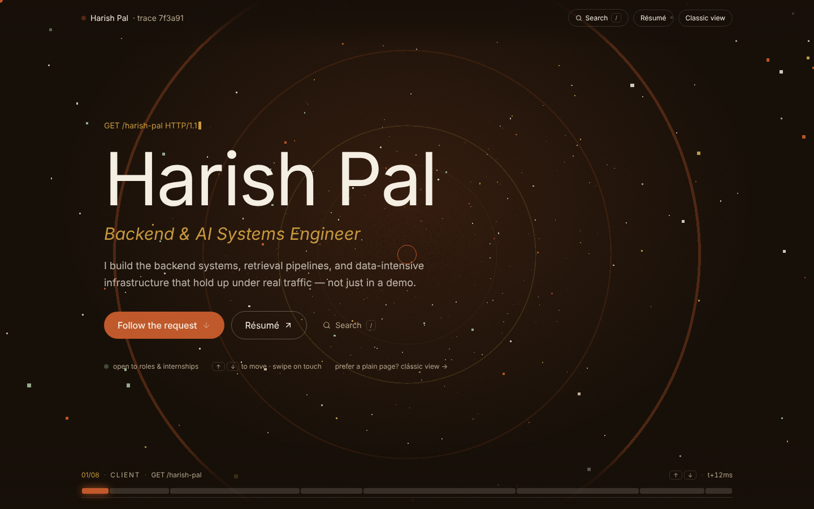

<div align="center">
  
## Hi, I'm Harish Pal 👋

**Backend & AI Systems Engineer**

I build the backend systems, retrieval pipelines, and data-intensive infrastructure that hold up under real traffic — not just in a demo. Currently studying Computer Science & AI, and shipping things in between.

<p>
  
  
  
  
  
  
</p>

📧 **harishpal0501@gmail.com** ·
[GitHub](https://github.com/harish05-q) ·
[Resume](./public/resume.pdf)
</div>
<p align="center">
  
</p>
---

## What I work on

I like systems that trace, retrieve, and reason over real data — root-cause analysis over payment failures, dependency graphs over unfamiliar codebases, semantic search over financial signal. Most of what I build sits at the intersection of solid backend engineering and applied AI.

- **R.AI** — Autonomous revenue recovery agent for 10K+ transactions: LLM diagnosis, deterministic policy enforcement, human approval, idempotent execution, and an AI-vs-baseline evaluation pipeline (66/66 backend tests passing).
- **PInSight** — Payment incident analysis platform with automated root-cause reasoning, built on FastAPI + PostgreSQL + pgvector.
- **CodeAutopsy** — Reverse-engineers a GitHub repo into architecture, dependency/call graphs, and searchable code insight via AST parsing + FAISS retrieval. [Live →](https://code-autopsy-nine.vercel.app)
- **QGen-AI** — Natural language to SQL, with schema-aware prompting and hard-enforced read-only query execution. [Live →](https://qgen-ai.onrender.com)
- **MarketIQ** — Real-time market intelligence platform indexing financial news with Qdrant for low-latency semantic search.
- **EduSwap** — Credit-based marketplace for students to share educational resources, built on Next.js + Supabase + Clerk.

Full write-ups for each — problem, approach, stack — are in the case-study drawers on the live site and on its `/projects` page.

## Field kit

`C++` `Java` `Python` `TypeScript` `FastAPI` `Node.js` `PostgreSQL` `MongoDB` `RAG` `LangChain` `FAISS` `Qdrant` `Docker` `AWS`

## A few marks worth noting

- 800+ DSA problems solved on LeetCode, 1850+ contest rating
- Top 10 finalist among 120+ teams at HackO'Clock national hackathon
- Published on SSRN: *"Predicting Growth-Induced Financial Collapse of SMEs Using Structural Cash-Flow Stress Modeling"*

## About this repo

This is the source for my personal site. The home page is an interactive journey: one request travelling through eight layers of a backend system (client → edge → service → agent → vector store → static analysis → incident log → response), with each layer being a part of my work. Navigate with ↑/↓, `1`–`8`, swipe, or the scroll wheel; press `/` or `Ctrl/⌘ + K` to search. A plain `/classic` version and a screen-reader text copy are included, and `prefers-reduced-motion` is respected.

Built with Next.js, TypeScript, Tailwind, Framer Motion and react-three-fiber. All content (projects, skills, bio, stats) lives in `lib/data.ts`; the journey reads from it, so you edit once and every view updates.

```bash
npm install && npm run dev
```

## License

MIT — see [`LICENSE`](LICENSE).
